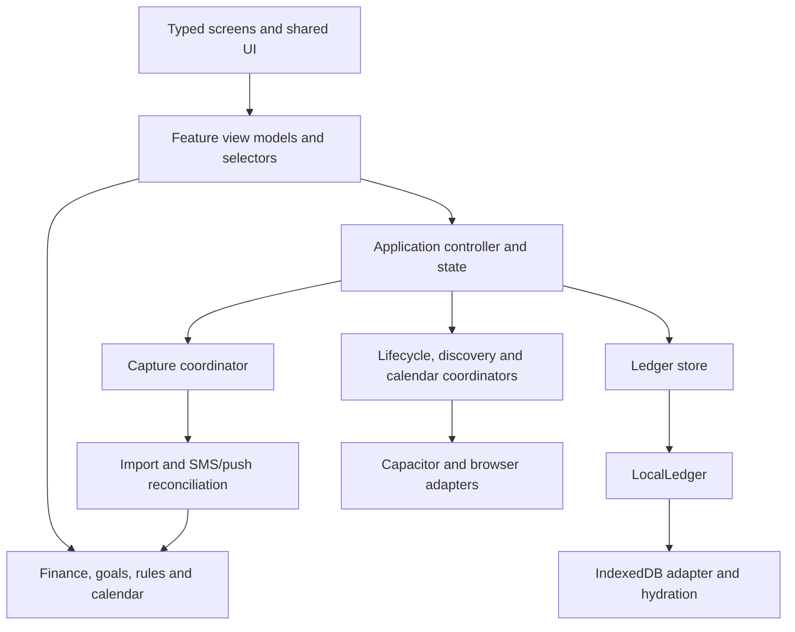

# Architecture

The application uses feature-based MVVM with a functional domain core, dependency-injected infrastructure and coordinators for asynchronous work. Screens receive typed view models; domain calculations do not depend on React, Capacitor or Supabase. Goal allocation uses the Strategy pattern for Queue and Share.

The 11 October 2026 refactor replaces the unchecked controller and untyped screen contracts. It preserves existing screen behavior, financial calculations, SMS/push reconciliation, durable data and the native unlock fix. The earlier [project audit](PROJECT-AUDIT.md) is historical.

## Ownership and interfaces

| Location | Responsibility |
| --- | --- |
| `src/domain/models.ts` | Shared account, transaction, profile, preference and pouch contracts. `capture-contract.ts` types the native capture configuration. |
| `src/application/controller.ts` | React orchestration: startup, navigation, authentication, state updates and persistence triggers. `state.ts` defines complete state and initial defaults; `routes.ts` declares all 24 supported routes. |
| `src/application/thaili-app.tsx` | Splash, locked state and application rendering. `src/lib/logic.tsx` is a compatibility export. |
| `src/features/*/view-model.ts` | Accounts, transactions, goals, insights, onboarding, settings, home and shell presentation. Each builder declares the actions and selector inputs it uses. |
| `src/features/*/screen-model.ts` | Feature-specific screen contracts. Shared UI components have smaller, component-specific props. |
| `src/features/*-context.ts` | Shared, transaction, insight, goal, setup and budget selectors. `context.ts` and `view-model.ts` compose them privately. |
| `src/features/transactions/commands.ts` | Transaction remarks, categories, filing rules, deletion and undo commands. Injected snapshot/commit/message ports make behavior testable. |
| `src/application/capture.ts` | One active capture read, event coalescing, independent successful-channel cursors, concurrent-edit preservation and cancellation on disposal. Calls the existing import pipeline. |
| `src/application/discovery.ts` | Installed-app scanning and SMS account discovery. Cancels stale scan results and preserves saved packages. |
| `src/application/lifecycle.ts` / `runtime.ts` | Listener ownership and cleanup, including native listeners whose registration finishes after disposal. Runtime supplies browser and Capacitor adapters. |
| `src/application/calendar-clock.ts` | Calendar rollover, resume refresh and midnight timer cleanup. Custom date selections keep their selected dates. |
| `src/application/ledger-store.ts` | Injected ledger/network coordinator owning subscribers, connectivity events and retry backoff. `src/lib/store.ts` supplies a local-only production boundary; cloud adapters are disconnected. |
| `src/lib/local-ledger.ts` | Durable snapshots, deletion markers, replay, local/cloud merges and acknowledgements, through local/cloud driver interfaces. |
| `src/infrastructure/hydration.ts` | Validates unknown saved/cloud data and whitelists preferences. Defaults missing legacy package/capture metadata; rejects corrupt or unknown-version local records. |
| `src/lib/indexed-db-storage.ts` | Reads/writes finish with the IndexedDB transaction. A failed read never initializes over existing data. |
| `src/lib/cloud-store.ts` / `src/infrastructure/database.ts` | Typed Supabase schema mapping, paginated reads, ordered writes and session identity checks. Tests use an injected client. |
| `src/lib/finance.ts`, `goals.ts`, `rules.ts`, `calendar.ts` | Pure financial calculations, allocation strategies, filing and dates. Money calculations use integer paisa. |
| `src/lib/import-transactions.ts` | Parsing, account resolution, transfers, filing and SMS/push deduplication with an explicit clock and ID generator. |
| `src/lib/device.ts`, `android/.../ThailiPlugin.java` | Platform-specific permissions, SMS, apps, capture, biometrics and haptics. |

Dependencies point toward models and domain behavior. Feature modules use type-only controller contracts; screen modules do not read storage or call device APIs. Async coordinators accept ports instead of importing React. This gives each module a useful responsibility without introducing an interface for every function.

The React controller remains a class to preserve navigation, lifecycle and rendering behavior during extraction. A hooks rewrite is not needed to use the new architecture. `AppState` remains one explicit application state; feature contracts limit what each feature consumes.

## Compatibility

The local ledger remains version 1. Existing IDs, balances, opening cutoffs, preferences, deletion revisions, ownership and pending replay survive hydration. Navigation/drafts/derived date fields are not persisted. Disabling raw-text retention retains the minimal evidence needed to reconcile SMS and push alerts.

This structural refactor requires no additional database migration. The earlier transaction-capture work still requires `supabase/migrations/20261011090000_transaction_capture.sql` before cloud sync; see [capture support](CAPTURE-SUPPORT.md).

## Setup import boundary (20 October 2026)

Automatic SMS/push import waits until setup is complete. Skipping the history preview saves `captureStartAt` and advances both read cursors. The durable boundary filters occurrence timestamps as well as limiting native queries, so overlapping SMS reads and recently buffered old notifications cannot reimport skipped history. New alerts from unselected providers are a separate unresolved audit finding. Accepting history explicitly retains the 90-day import window. Finishing setup starts live capture immediately; a newer import decision invalidates a queued capture commit.

The boundary is an optional preference in the existing JSON settings; no schema migration is needed. Existing completed installations without it retain their prior capture behavior. Previously imported transactions are not removed automatically, since older records do not establish whether the user accepted them.

A confirmed zero opening is valid. Detected placeholder accounts still require confirmation, and saving an account without an opening timestamp establishes one even when the amount is unchanged. Confirmed unchanged balances retain their cutoff when editing other account details.

## Validation

- `npm run typecheck` checks application code and check-file fixtures separately, with no `@ts-nocheck` or explicit `any` in source.
- `npm test` runs 26 check files: existing financial, parser, import, authentication, navigation, cloud and offline-ledger coverage plus application flow, capture, discovery, listener cleanup, calendar, store retries and hydration checks.
- Application flow checks exercise registration, manual onboarding, expenses, edits, deletion/undo, goals and saved snapshots. All 24 supported screens render with empty/populated data in both languages (96 renders).
- A temporary comparison against the original controller verified the serialized displayed values and available actions for 28 routes across five states (140 comparisons).
- A Chrome guest session with Supabase disabled completed onboarding, saved a synthetic Rs 5,000 opening and Rs 100 expense, edited its remark, and restored Rs 4,900 and the edited remark after reload. The guest session was closed after verification.
- Production static export, Android unit tests and debug APK assembly pass. Lint has zero errors and two image performance warnings.
- `.github/workflows/checks.yml` repeats type checking, checks, lint, web build and Android checks for pushes and pull requests.

Live bank alerts, background capture and biometric prompts still require physical-device validation. Hosted cloud behavior was not exercised by this refactor's tests; the adapter checks use a fake client.

## Functional follow-ups

On 20 October 2026, the unenforced sync/recovery feature was removed, including its routes, actions and production cloud connection. The app is local-only even with backend environment variables present. Native capture and local review notifications remain enabled. The fake review note/receipt actions were removed; Details retains its working note editor. See [remediation decisions and recommendations](LOGIC-REMEDIATION.md).

Other existing product gaps include transfer destination cleanup when removing an account, incomplete localization/balance masking and empty-income budget wording. CSV export, archive browsing and spend prompts remain unimplemented as listed in the README (a JSON backup export exists).

For future changes, add domain behavior and its checks first, wire it through the owning application/feature module, then update that feature's screen contract. Keep platform and transport details in adapters.

## Setup number entry (21 October 2026)

Account details use real numeric-keyboard text inputs so native cursor movement, selection,
backspace and paste can edit individual digits. The active field has a visible Editing label,
strong border and tinted background. Account/mobile suffixes retain leading zeros; amount drafts
normalize an initial zero when followed by another digit, while preserving decimal values such as
`0.05`. Empty and trailing-decimal drafts remain editable. The shared `numericEntry` helper also
applies this amount behavior to the savings-baseline keypad. Account suffixes remain limited to four
digits, and amounts to nine whole digits and two decimal places.

Browser checks exercised phone/account digit replacement, backspace, next-field focus, rapid typing,
zero/decimal behavior, formatted paste, validation, wallet/bank field labels, 320px layout and local
save/reopen with synthetic data. Native keyboard placement still needs physical-device confirmation.
