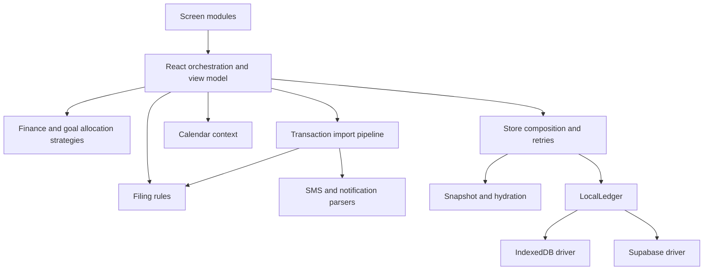

# Architecture and refactor review

Reviewed the current working tree on 7 October 2026, including the changes already present before this refactor. The earlier [project audit](PROJECT-AUDIT.md) is historical; several of its persistence and parser findings have since been addressed.

## Design choices

Use a layered architecture with a functional domain core. Financial decisions belong in small, independently callable interfaces; React owns screen state, device events and formatting. Use the Strategy pattern where behavior actually varies: Queue and Share goal allocation. Keep the existing dependency-injected ledger and give its persistence adapters separate files.

## Module interfaces

| Module | Interface and responsibility |
| --- | --- |
| `finance.ts` | `accountBalances`, `monthlyBudget`, `monthlySavingsRate`, `essentialMonthly`: ledger data in, financial results out; no React, device or network imports. |
| `goals.ts` | `savingsGoal` validates drafts; `allocateGoals` reserves the baseline and dispatches to private Queue/Share strategies. No mutation of callers' goals. |
| `rules.ts` | Keyword normalization, priority matching, validation, refiling and removal. Manually assigned categories survive refiling. |
| `import-transactions.ts` | `importTransactions(messages, context)` runs parsing, account resolution, transfer recognition, filing and deduplication. Context supplies accounts, rules, existing transactions, clock and ID generator. |
| `calendar.ts` / `bs.ts` | `calendarAt(today)` gives coherent date labels and period values; `dated(entry, today)` derives transient transaction date fields. |
| `pouch.ts` | `snapshot`, `hydrated`, `prefsOf`: select durable fields and apply SMS/app raw-text retention. UI drafts, navigation and derived dates are excluded. |
| `local-ledger.ts` | Durable snapshot, deletion markers, local/cloud merge, replay and acknowledgement. Depends on `LocalStorageDriver` and optional `CloudDriver`. |
| `indexed-db-storage.ts` | `indexedDbStorage()` satisfies the local driver; reads and writes complete with the IndexedDB transaction. |
| `cloud-store.ts` | `createCloudDriver(db, ensureSession)` satisfies the cloud driver. Owns schema mapping, paginated reads, ordered writes and session identity. Tests inject a fake client without contacting a server. |
| `store.ts` | Creates the concrete ledger, selects the adapters, publishes storage status and schedules retries. |
| `logic.tsx` | Orchestrates device and screen state, calls domain interfaces and formats screen view models. |

The ledger already had useful driver seams. The 7 October extraction preserved its durable format and merge/retry rules without a database migration or new dependency. The later capture work adds a migration, described in [capture support](CAPTURE-SUPPORT.md). Existing uncommitted work is retained.

## Correctness changes

- Balances and monthly budget sums use integer paisa internally. Opening timestamps remain inclusive cutoffs; each account applies its own cutoff when receiving a transfer. Balances are computed once per render, rather than rescanning all transactions for every displayed amount.
- Both goal strategies cap allocations at their targets, reserve the baseline and conserve every paisa. Share rounding cannot allocate more than the available surplus; excess from capped goals spills in priority order.
- Goal estimates use net flows into accounts marked savings over the current and preceding two BS months. Transfers between spending accounts or between savings accounts contribute zero. Withdrawals and savings expenses reduce the rate. A nonpositive rate yields `waitMonths: null`, displayed as insufficient savings history; funded goals remain reached.
- Financial dates no longer use a module-load timestamp. The app refreshes transaction offsets on resume and at midnight, advances the default calendar month, and shifts custom offsets to preserve selected dates. The midnight timer is removed on unmount.
- SMS account matching and transfer pairing now preserve caller types rather than returning untyped arrays. The import pipeline is independently testable with fixed time and identity.
- The legacy React class now enables undefined-variable linting even while its broader type/lint suppression remains. An existing explicit-`any` lint error in the ledger test was corrected.

## Validation

`npm test` runs the existing parser, navigation, formatting, transaction, goal, money-app, notification and offline-ledger checks, plus financial, filing, import and concrete cloud-adapter checks.

Coverage includes opening cutoffs, transfer conservation, paisa arithmetic, month-end budgets, net savings direction, both allocation strategies across 501 surplus amounts each, capped shares, insufficient-history estimates, rule priority/manual categories, import deduplication/orphans/wallet pairing, BS month rollover, 1,201-row pagination, raw retention, replay of deletion markers, failed writes and changed session identity. Existing offline restart, undo, disk-failure and concurrent-edit checks continue to pass.

TypeScript checking and the production static build pass. Lint has no errors and retains one pre-existing Home `` performance warning. Native Android behavior and a hosted Supabase backend were not exercised during this refactor.

A browser smoke check used a temporary Chrome guest session and a preview with both Supabase environment variables empty. Completed manual onboarding, saved a synthetic Rs 5,000 opening, recorded a Rs 100 expense and verified Rs 4,900 on Home. Insights showed the expense, a custom goal showed insufficient savings history, and switching from Queue to Share updated the funding badge. Reloading restored the account, expense and goal from IndexedDB. Browser data was confined to that guest session, which was closed after verification.

## Remaining review findings

These are follow-up work, not functionality delivered by the architectural extraction:

1. **P1 — Cloud controls and identity:** store retries depend on Supabase configuration, while the visible sync/account choices still belong to prototype screens. OTP, restore, backup/device and remote-delete success messages remain simulated. Raw retention still defaults to enabled in React state. Real transport policy and verified identity need their own implementation; moving the adapter does not solve them.
2. **P2 — Legacy presentation typing:** `logic.tsx` remains a large class with `@ts-nocheck`, and the persisted pouch and screen models still contain permissive types. The extracted financial, allocation, filing, import and calendar modules are checked independently. Next work should type the shared persisted model, then split view models by screen and enable class checking.
3. **P2 — Account edits:** zero opening balances are still rejected by the manual-account form. Removing a source still leaves some transfer destination references in memory; the cloud adapter sanitizes missing destinations, but the client mutation and undo should enforce the same rule.
4. **Capture reconciliation — addressed 2026-10-11:** sender matching now resolves institutional identity for accounts added by hand. The importer reconciles SMS/push evidence and identified wallet-transfer credits against existing history across separate reads. See [capture support](CAPTURE-SUPPORT.md) for coverage, migration requirements and device-validation limits.
5. **P2 — Product feedback:** the empty-income budget state can still describe Rs 0 as an overspend. Localization and consistent balance masking remain incomplete.

Future changes should extend the appropriate domain interface and test it there, then update React callers. Keep device and transport details out of financial modules, and avoid wrappers that only forward calls without owning behavior.
